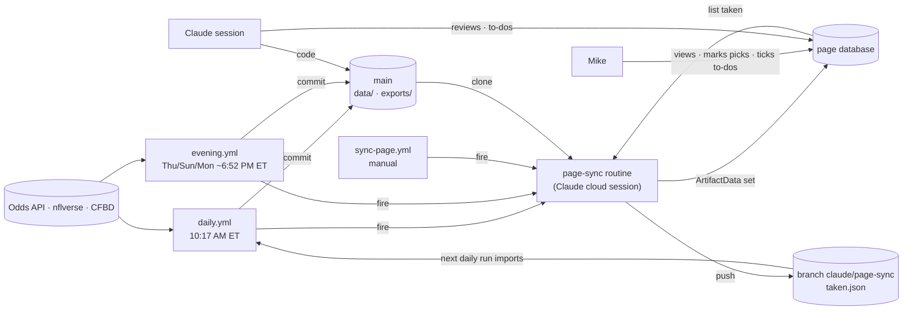

# Architecture (before Oct 6, 2026)

> **Historical.** Since Oct 6 the Railway worker runs the schedule and the web and iPhone apps replace the claude.ai
> page: see `CLAUDE.md` ("How it runs") and `docs/APP_PLAN.md`. This file describes the GitHub Actions and routine setup
> that came before, kept for the rollback path.

BetLab runs without Mike's PC. GitHub Actions does the data work, a Claude cloud
routine copies results onto a private claude.ai page, and the git repository is
the durable record of everything.

## The pieces

| Piece | Where | Job |
|---|---|---|
| Repository | github.com/mopsha/betlab (private), branch `main` | Code, config and all committed data. Source of truth; every paper pick is timestamped by the commit that logged it |
| GitHub Actions | `.github/workflows/` | `daily.yml` (the pipeline), `evening.yml` (pre-kickoff re-price), `reprice.yml` (midday), `nba.yml` (NBA props before tip-off, from Oct 20), `tick.yml` (starts the others on time), `sync-page.yml` (manual page refresh), `ci.yml` (tests) |
| Page-sync routine | Claude cloud routine "BetLab page sync", `trig_01AsDvmu7oHR6WcVyBvNSJLH` | Uploads the export bundle into the page's database; saves Mike's "Mark as mine" taps to branch `claude/page-sync` |
| The page | https://claude.ai/artifact/6QKwcwXB9a5c3imy692S39 | What Mike looks at: Today, To-do, Results, Review, Learn. Source in `page/index.html` |
| Page database | The artifact's `db` capability (JSON document store) | Display copies of the card/results/ledger, plus data Mike creates on the page (taps, to-dos) |
| Claude sessions | Claude Code on Mike's PC, or on the web against the repo | Building and changing code, reviews, seeding the page. Not needed for daily operation |
| Outside data | The Odds API, nflverse, CollegeFootballData | Odds and stats; see `DATA_SOURCES.md` |

## Flow

## A normal day (times ET)

| Time | What runs | Result |
|---|---|---|
| 10:17 AM (9:17 AM after Nov 1) | `daily.yml` | Taps imported, college data refreshed, picks graded, odds pulled where games are within 36 h, card priced, bundle exported, commit pushed |
| ~10:20 AM | Page-sync routine (started by `daily.yml`) | Page shows the new card and results |
| Sunday 11:47 AM | `daily.yml` again | Re-price after early NFL news; the odds pull usually skips because the league was already pulled that day |
| Thu/Sun/Mon ~6:52 PM | `evening.yml` | If an NFL game kicks off in 30–110 min: fresh odds (≈3 credits), re-priced card, commit, page sync |
| Nightly from Oct 20, at 20 past the hour, 6:20–10:20 PM (5:20–9:20 in standard time) | `nba.yml` | If an NBA game tips in 15–75 min: its props (≈8 credits a game) and the game lines, card with NBA props, NBA tracker rows, commit, page sync |
| Any time | `sync-page.yml` (Actions tab → Run workflow) | Page refreshed from what's committed |

**Who starts the runs:** GitHub's own cron started them 2–4 hours late on this repo
(Sep 24), so scheduled Claude routines (the "BetLab tick" routines) push an empty
commit to `claude/tick` naming the run, and `tick.yml` starts it on `main` with
`workflow_dispatch` (under 30 seconds end to end). Times are UTC: daily 14:17 (plus
15:47 Sundays), shifting one hour earlier in Eastern time when daylight saving ends
(Nov 1); evening 22:52 and 23:52 Thu/Sun/Mon, where the kickoff-window check makes the
off-hour run skip for free. `daily.yml` keeps its GitHub cron as a fallback; a second
daily run the same day is harmless.

## What each daily step reads and writes

| Step (CLI) | Reads | Writes |
|---|---|---|
| import taps (`betlab import-taken`) | `claude/page-sync:data/ledger/taken.json` | `taken`, `taken_price`, `taken_stake` columns of `data/ledger/picks.csv` |
| `betlab refresh` | CFBD API (6 calls) | `data/history/ncaaf_games.parquet` (current season replaced) |
| `betlab grade` | nflverse + CFBD history, `data/models/*_params.json` | result/CLV columns of `picks.csv`; `exports/results.json` |
| `betlab pull --auto` | Odds API (free `/events` check, 3 credits per league pulled) | `data/odds/<sport_key>/<date>/<HHMMSS>_pick.parquet`; `data/odds_api_usage.csv` |
| `betlab card` | latest snapshot per league, games tables, model settings | `exports/card.json`, `exports/card.md`, `exports/cards/<date>.json`; new rows in `picks.csv` |
| `betlab export-page` | `exports/card.json`, `exports/results.json`, `picks.csv`, usage log | `exports/page_sync/*.json` + `manifest.json` |
| commit | everything above | a `daily run <date>` commit by `betlab-bot` |
| `scripts/fire_page_sync.sh` | `ROUTINE_TOKEN` secret | starts the routine (HTTP 200) or fails the workflow |

The routine then does two things:
- It uploads each manifest entry to the page (`app/card`, `app/results`, `app/meta`,
  `ledger/<YYYY-MM>`), pinning the document versions it read.
- It lists the page's `taken` collection and force-pushes it as
  `data/ledger/taken.json` to `claude/page-sync`.

Its exact prompt is in `docs/archive/ROUTINE_PROMPT.md`.

## Where state lives

| State | Home | Written by | Notes |
|---|---|---|---|
| Code, config | git `main` | Claude sessions | Cloud runs use only pushed code |
| Odds snapshots, ledger, history, model settings, credit log | git `main` under `data/` | daily/evening runs, Claude sessions | Durable; small files |
| Card, results, page bundle | git `main` under `exports/` | daily/evening runs | Regenerated each run |
| Mike's marked picks | page db `taken/*` → git `claude/page-sync` → `picks.csv` | the page, the routine, the daily run | One-day lag into the ledger |
| To-do list | page db `todos/*` only | Mike on the page, Claude via ArtifactData | Not in git; read it every session |
| Reviews | page db `reviews/*` | Claude sessions | Weekly write-ups |
| API keys | GitHub secrets; local `.env` | Mike only | Never read or written by Claude |
| nflverse cache | `actions/cache` | `daily.yml` | Convenience only |

## Failure handling

- **Missing API key:** `pull` and `refresh` print a skip message instead of crashing,
  so the rest of the run continues.
- **One league fails to price:** the card gets a note ("NCAAF: pricing failed (...)")
  and the other leagues still publish.
- **League data not built:** `ready()` in `cli.py` keeps odds credits from being spent
  on a league we can't price.
- **Credit budget:** `CreditGuard` refuses calls that would drop the balance below the
  50-credit reserve. Only closing-line pulls may use the reserve.
- **Page sync rejected** (bad or revoked token): `fire_page_sync.sh` exits non-zero, the
  workflow fails, and GitHub emails Mike.
- **Routine hiccups:** these show up in the routine's run list. The page's "Priced ..."
  and "Updated ..." stamps show staleness.
- **Overlapping runs:** the `betlab-data` concurrency group makes daily and evening runs
  queue instead of racing.

## Security boundaries

- **Keys:** they exist only in GitHub secrets and Mike's `.env`. Workflow logs mask
  them, and the Odds API client never echoes request URLs.
- **The routine:**
  - It sees only `mopsha/betlab` (the Claude GitHub App is installed on that repo alone).
  - It has no connectors and can push only `claude/`-prefixed branches.
  - Its token can start that one routine and nothing else, and it ignores any fire
    payload text.
- **The page:** it's private to Mike, and whatever the page database holds is treated
  as data, never as instructions (the routine prompt says so).
- **Real money** never moves through any part of this system.
